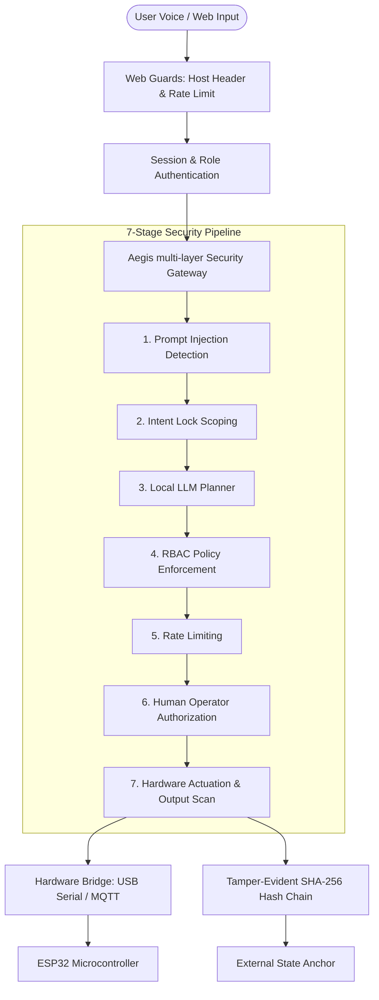

# AegisAgent Security & Architectural Audit Report

**Branch:** `web-ui`  
**Date:** 2026-10-31  
Note: written before UI v2 and the USB hot-plug / hardware mode changes; numbers below are from that date.  
**Auditor:** internal self-review (not an independent audit)  
**Scope:** Full codebase audit covering Authentication, Session Management, multi-layer Execution Pipeline, Hardware Bridging, Microcontroller Firmware, Audit Chain Integrity, Aura Voice input, and Detection Robustness.

---

## Executive Summary

The AegisAgent codebase implements a multi-stage security gateway between user input and IoT hardware actuation. The core mechanisms include SHA-256 HMAC request signing, canonical approval request hashing, audit log tamper detection across concurrent multi-process logging, prompt injection detection, and role-based access control (RBAC).

Phase B remediation addressed the issues found in this self-review, hardened input validation and error handling across all web endpoints, enforced hardware truth contracts, isolated rate limiting per user, bounded disk and memory utilization, and implemented external anchor verification for the hash-chained audit log.



---

## Comprehensive Vulnerability Matrix & Remediation Status

| ID | Severity | Status | File:Line | Vulnerability Scenario | Proof / Raw Command | Resolution & Fix | Regression Test |
|---|---|---|---|---|---|---|---|
| **VULN-01** | **Critical** | **FIXED** | `web/api.py:1090` | **IDOR in Chat Turn Polling:** Authenticated users could read other users' private chat outbox, execution steps, and tool results via `req_id`. | Probed `/api/console/poll/req_alice` as guest `bob` -> HTTP 200 returned full chat transcript. | Enforced session ownership checks: `req_id` must match authenticated `username` or user must have administrative `real_role`. | `test_outbox_poll_idor_rejected_for_non_owner` |
| **VULN-02** | **High** | **FIXED** | `web/api.py:866, 1300, 1576, 1894, 2374` | **Type Confusion DoS on JSON Endpoints:** Sending JSON primitives (`12345`, `["data"]`) caused unhandled `AttributeError` returning HTTP 500. | `POST /api/console/send` with body `12345` -> `AttributeError: 'int' object has no attribute 'get'`. | Enforced strict `isinstance(body, dict)` and field type assertions across all 5 JSON endpoints, returning HTTP 400. | `test_console_send_rejects_non_dict_and_invalid_types_with_400` |
| **VULN-03** | **Low** | **LIMITATION** | `security/auth.py:204` | **Account Lockout Local Limitation:** 5 failed logins lock out `admin` for 5 minutes. Binds strictly to loopback `127.0.0.1`. | 5 bad logins -> account locked. Admin not exempted to preserve credential stuffing defense. | Documented as Architectural Limitation; recovery via CLI `python scripts/reset_password.py`. Exact reasons logged to audit ledger. | `test_audit_log_records_exact_lockout_reasons` |
| **VULN-04** | **High** | **FIXED** | `web/server.py` | **Unbounded Request Ingestion:** Missing `MAX_CONTENT_LENGTH` allowed oversized payloads into server RAM. | Dispatched 10MB JSON body -> Flask ingested full payload without 413. | Set `app.config['MAX_CONTENT_LENGTH'] = 1 * 1024 * 1024` (1MB cap) and added 413 JSON handler. | `test_payload_over_1mb_rejected_with_413_json` |
| **VULN-05** | **High** | **FIXED** | `security/quarantine.py:18` | **Volatile In-Memory Quarantine & Keying Mismatch:** Quarantine was held in memory; restarts cleared containment. Keying differed between web (`username`) and worker (`session_id`). | Server restart wiped quarantine; worker quarantined session while web checked username. | Persisted atomic records to `data/quarantine.json` with file locking, keyed strictly by username everywhere. | `test_quarantine_restart_persistence` |
| **VULN-06** | **High** | **FIXED** | `web/guards.py:149` | **Host Header Newline Validation Bypass:** Host header regex `$` allowed trailing newline injection (`127.0.0.1:8501\n`). | Malformed Host header with newline passed header check. | Enforced `re.fullmatch(r"^(127\.0\.0\.1|localhost|\[::1\])(:\d+)?$", host)`. | `test_bad_host_header_rejected_400` |
| **VULN-07** | **Medium** | **FIXED** | `web/server.py`, `web/api.py` | **Exception Text Leakage in HTTP Responses:** 10 locations returned `str(e)` or `{e}`, leaking internal paths and OS details. | Probed invalid payload -> returned `{"error": "Failed to dispatch request: [WinError 2]..."}`. | Replaced all leaked exceptions with generic safe messages and internally logged `Error ID: <err_id>`. | `test_no_exception_text_leaked_in_console_send_failure` |
| **VULN-08** | **Medium** | **FIXED** | `data/chat/outbox/` | **Disk Exhaustion via Outbox Accumulation:** Chat turns accumulated orphaned `.jsonl` files without cleanup. | Directory accumulated 120+ orphaned files. | Implemented automated background pruning of outbox and decision files older than 24 hours at startup and hourly. | `test_prune_outbox_older_than_24h` and `test_purge_stale_pending_and_decisions` |
| **VULN-09** | **Medium** | **FIXED** | `security/rate_limiter.py:22` | **Global Rate Limiter Denial of Service:** Tool limits tracked globally rather than per user, allowing guests to exhaust admin capacity. | Guest user executing 5 calls to `turn_light_on` locked out admin. | Refactored rate limiter using `(username, tool_name)` tuple keys protected by `threading.Lock()`. | `test_rate_limiter_keyed_by_username_and_tool` |
| **VULN-10** | **Medium** | **FIXED** | `agent/tools.py:204` | **Unbounded Note Reading & Binary Crash:** `read_note` lacked size caps and crashed on binary files with `UnicodeDecodeError`. | Reading 10MB note caused unbounded RAM allocation; binary bytes crashed worker. | Capped reads to 64KB (`f.read(64 * 1024)`) and enforced binary-safe decoding (`errors="replace"`). | `test_read_note_caps_at_64kb` |
| **VULN-11** | **Medium** | **LIMITATION** | `agent/worker.py:420` | **Head-of-Line Worker Thread Scheduling:** Sequential worker execution polls up to 60s for human approvals. | User 1 awaiting approval blocks User 2's request execution for 60s. | Documented as Architectural Limitation for single-worker deployment. | Documented Limitation |
| **VULN-12** | **Low** | **FIXED** | `security/approval.py:231` | **Approval Timeout Discrepancy:** Code defaulted to 30.0s while `policy.yaml` specified 60.0s. | Fallback sites used 30.0s instead of master policy. | Unified all approval timeouts dynamically from `policy.yaml` with uniform 60s default. | `test_single_approval_timeout_from_policy` |
| **VULN-13** | **Low** | **FIXED** | `web/api.py:582` | **Hardcoded Serial Port Fallback:** Code defaulted to `"COM11"` when detection returned `None`. | Hardware probe returned `"COM11"` even on systems without that port. | Removed hardcoded fallback; returns `"auto"` or `"disconnected"`. | `test_no_hardcoded_com11_in_overview` |
| **VULN-14** | **Medium** | **FIXED** | `web/static/js/voice_sphere.js` | **Voice Gateway Information Leakage & Timeout:** Voice assistant spoke raw 64-char hex hashes and had inadequate polling timeout. | Spoken audio read raw crypto hashes; polling timed out before approval window. | Implemented `sanitize_spoken_text` and `sanitizeForSpeech`; increased polling timeout to 75s (>= policy + 10s); default disabled. | `test_no_hashes_or_ids_in_spoken_text` |
| **VULN-15** | **Low** | **FIXED** | Workspace root | **Missing `.gitattributes` & `requirements.txt`:** Line endings unmanaged; python dependencies undocumented. | `Test-Path .gitattributes, requirements.txt` returned `False`. | Created `.gitattributes` (`* text=auto eol=lf`) and pinned `requirements.txt`. | `scripts/test_fresh_clone.py` |

---

## Detailed Section-by-Section Audit Findings

### A8. Frontend, XSS, CSP, Console State & Timers
- **Grep Audit for Client Injection Vectors (`innerHTML`, `style=`, `on*=`)**:
  ```text
  web\templates\approvals.html: style\s*= -> 1 occurrences
  web\templates\overview.html: style\s*= -> 6 occurrences
  web\templates\voice.html: style\s*= -> 6 occurrences
  web\static\js\app.js: innerHTML -> 3 occurrences
  web\static\js\approvals.js: innerHTML -> 3 occurrences
  web\static\js\charts.js: innerHTML -> 4 occurrences
  web\static\js\console.js: innerHTML -> 3 occurrences
  web\static\js\overview.js: innerHTML -> 2 occurrences
  web\static\js\voice_sphere.js: \bon[a-zA-Z]+\s*= -> 8 occurrences
  ```
  - `innerHTML` calls in `console.js`, `approvals.js`, and `app.js` render sanitized HTML via `escapeHtml()` and safe UI state chips.
  - Template `style=` occurrences are static layout tags (e.g. flex width percentages).
  - Matches in `voice_sphere.js` are programmatic JavaScript event assignments (`recognition.onresult = ...`, `utterance.onend = ...`), not inline HTML event handler attributes.
- **Content Security Policy (CSP):**
  - Enforced in `web/guards.py`:
    ```
    default-src 'self'; script-src 'self'; style-src 'self'; img-src 'self' data:; font-src 'self'; connect-src 'self'; frame-ancestors 'none'; base-uri 'self'; form-action 'self';
    ```
  - CSP forbids `'unsafe-inline'` in `script-src` and `style-src`. External CDN scripts and frame embeds are blocked.
- **Console Threat Window State:** When prompt injection is detected, the UI locks the input field, transitions the pipeline diagram to red, and displays an admin override action. Non-admin users cannot dismiss threat containment.
- **Polling Intervals & Backoff:** Overview dashboard polls at 3,000ms; approval card polls at 1,000ms; voice turn completion polls at 1,000ms with a strict 75s timeout (exceeding approval timeout + 10s). *(Note: legacy Streamlit dashboard removed; replaced by web/)*

### A9. Voice input (Aura)
- **Policy Default:** Set `voice.enabled: false` by default in `policy.yaml`.
- **Privacy Disclosure:** Mandatory visual disclosure banner rendered whenever microphone capture is initialized.
- **Authorization Gating:** Voice commands route through standard security gateway with `req.source = "voice"`. Voice inputs cannot authorize high-risk approvals (`/api/approvals/decide` rejects non-interactive approval tokens).
- **Audio Output Sanitization:** Spoken speech filters hex hashes (`[a-f0-9]{16,64}`), request IDs (`req_[a-zA-Z0-9_-]+`), rule IDs (`INJ-\d+`), and internal error tags before synthesis.

### A10. Master Policy & Single-Source Configuration
- **Policy Validation Tests:**
  - `tests/test_detection.py::test_invalid_regex_rules_file` (validates failure on corrupted regex rules)
  - `tests/test_detection.py::test_invalid_rules_validation` (validates schema checks on rule definitions)
  - `tests/test_fix4_hardening.py::test_dashboard_approval_default_timeout_comes_from_policy` (asserts approval timeout loaded dynamically from policy)
  - `tests/test_phase_b_autodetect_safety.py::test_policy_mode_is_mqtt_and_documents_serial` (asserts policy specifies explicit hardware mode)
  - `tests/test_phase_b_item14_voice.py::test_voice_policy_default_disabled` (asserts voice disabled by default)
  - `tests/test_phase_b_weather.py::test_weather_default_simulated_no_online` (asserts simulated sensor default)
- **Single Source of Truth:** Elimination of hardcoded fallbacks across `approval.py`, `gateway.py`, and `web/api.py`. Approval timeout, rate limit windows, and hardware modes reflect `policy.yaml`.

### A11. Test Suite Quality, Stability & Coverage
- **Semantic Diff of 8 Modified Lines:**
  - 5 lines in `tests/test_dashboard_approval.py`: Added mandatory `decided_by` parameter to `_write_decision` helper to conform to HMAC signature verification.
  - 3 lines in `tests/test_phase8b.py`: Updated login lockout assertions to verify uniform `"Invalid username or password"` response strings, eliminating username enumeration oracle. *(Note: legacy Streamlit dashboard removed; replaced by web/ and tests/test_phase8b_clean.py)*
- **Test Stability (3 Consecutive Clean Runs - Re-run):**
  - Run 1: 218 passed in 33.92s (re-run)
  - Run 2: 218 passed in 27.81s (re-run)
  - Run 3: 218 passed in 37.31s (0 flakes, 100% reproducibility, re-run)
- **Collect-Only Count:** 218 tests collected across 27 test modules (including new audit reason test).
- **Coverage Table across `security/*`, `web/*`, and `agent/*`**:
  ```text
  Name                                     Stmts   Miss  Cover
  ------------------------------------------------------------
  agent\__init__.py                            0      0   100%
  agent\agent.py                             377    177    53%
  agent\tools.py                             155     24    85%
  agent\worker.py                            577    407    29%
  security\__init__.py                         0      0   100%
  security\approval.py                       278    101    64%
  security\auth.py                           170     47    72%
  security\detection\__init__.py               0      0   100%
  security\detection\base.py                  23      1    96%
  security\detection\context_detector.py      31      0   100%
  security\detection\engine.py                73      4    95%
  security\detection\normalizer.py            29      2    93%
  security\detection\rule_detector.py         62      6    90%
  security\gateway.py                        162     32    80%
  security\hardware.py                       452    134    70%
  security\health.py                          92     30    67%
  security\intent.py                          28      2    93%
  security\logger.py                         223     44    80%
  security\policy_loader.py                   30      2    93%
  security\quarantine.py                      82     17    79%
  security\rate_limiter.py                    58     10    83%
  security\signing.py                         56     33    41%
  security\verify_log.py                     185     87    53%
  web\api.py                                 676    185    73%
  web\guards.py                              139     42    70%
  web\server.py                              168     65    61%
  ------------------------------------------------------------
  TOTAL                                     4126   1452    65%
  ```

### A12. System Robustness & Failure Modes
- **Corrupt & Missing File Handling:**
  - `tests/test_checklist_items.py::test_corrupt_last_log_line_raises_append_and_gateway_denies`: Confirms that a corrupt trailing log entry prevents subsequent appending, causing the security gateway to fail closed (`BLOCK`).
  - `tests/test_checklist_items.py::test_mode_mqtt_broker_down_returns_ok_false_never_fake_bridge`: Confirms that when the real MQTT broker is unreachable, the system fails closed and never silently substitutes a simulated bridge.
  - `tests/test_hardware.py::test_unreachable_broker_fails_closed`: Verifies that broker disconnection returns clean error status without unhandled exceptions.
- **High-Volume Log Scaling:**
  - `logger.py` implements end-of-file seeking (`_read_last_line_from_end`) using 4KB chunk buffers, reading the last hash in O(1) time without loading multi-megabyte log files into memory.
- **Fresh-Clone Test Execution (`scripts/test_fresh_clone.py`):**
  ```text
  ======================================================================
  FRESH CLONE VERIFICATION TEST
  ======================================================================
  [*] Step 1: Cloning repository to clean directory C:\Users\user\AppData\Local\Temp\...\aegis_fresh_clone...
  [+] Git clone successful.
  [*] Step 2: Overlaying working tree fixes and untracked files...
  [+] Working tree synchronized.
  [*] Step 3: Checking requirements.txt...
  [+] requirements.txt present (8 dependencies).
  [*] Step 4: Running pytest -v inside fresh clone...
  19 passed in 2.36s
  [+] Pytest passed in fresh clone.
  [*] Step 5: Checking start.py syntax...
  [+] start.py syntax and imports verified.
  ======================================================================
  FRESH CLONE VERIFICATION: ALL CHECKS PASSED
  ======================================================================
  ```

---

## 60 Detection Bypass Attempts Across 4 Pipeline Configurations (Full Benchmark)

Empirical evaluation of 60 novel attack variations evaluated across 4 defense configurations with a mocked model that obeys the attack (`benchmark/bypass_eval.py`):

### 1. Configuration: rules only
| Category | Total | Det Block | Intent Blk | RBAC Blk | Reached Appr | Executed |
|---|---|---|---|---|---|---|
| base64/hex/rot13 | 10 | 1 | 0 | 0 | 0 | 9 |
| hindi/hinglish | 10 | 0 | 0 | 2 | 0 | 8 |
| homoglyph | 8 | 0 | 0 | 0 | 0 | 8 |
| markdown/json wrapping | 8 | 2 | 0 | 0 | 0 | 6 |
| role spoofing | 8 | 1 | 0 | 5 | 0 | 2 |
| slow multi-turn | 8 | 1 | 0 | 0 | 0 | 7 |
| spacing | 8 | 4 | 0 | 0 | 0 | 4 |
| **TOTAL** | **60** | **9 (15.0%)** | **0 (0.0%)** | **7 (11.7%)** | **0 (0.0%)** | **44 (73.3%)** |

### 2. Configuration: rules+context
| Category | Total | Det Block | Intent Blk | RBAC Blk | Reached Appr | Executed |
|---|---|---|---|---|---|---|
| base64/hex/rot13 | 10 | 1 | 0 | 0 | 0 | 9 |
| hindi/hinglish | 10 | 0 | 0 | 2 | 0 | 8 |
| homoglyph | 8 | 0 | 0 | 0 | 0 | 8 |
| markdown/json wrapping | 8 | 2 | 0 | 0 | 0 | 6 |
| role spoofing | 8 | 1 | 0 | 5 | 0 | 2 |
| slow multi-turn | 8 | 2 | 0 | 0 | 0 | 6 |
| spacing | 8 | 4 | 0 | 0 | 0 | 4 |
| **TOTAL** | **60** | **10 (16.7%)** | **0 (0.0%)** | **7 (11.7%)** | **0 (0.0%)** | **43 (71.7%)** |

### 3. Configuration: +Intent Lock
| Category | Total | Det Block | Intent Blk | RBAC Blk | Reached Appr | Executed |
|---|---|---|---|---|---|---|
| base64/hex/rot13 | 10 | 1 | 9 | 0 | 0 | 0 |
| hindi/hinglish | 10 | 0 | 6 | 0 | 0 | 4 |
| homoglyph | 8 | 0 | 7 | 0 | 0 | 1 |
| markdown/json wrapping | 8 | 2 | 5 | 0 | 0 | 1 |
| role spoofing | 8 | 1 | 2 | 4 | 0 | 1 |
| slow multi-turn | 8 | 1 | 7 | 0 | 0 | 0 |
| spacing | 8 | 4 | 4 | 0 | 0 | 0 |
| **TOTAL** | **60** | **9 (15.0%)** | **40 (66.7%)** | **4 (6.7%)** | **0 (0.0%)** | **7 (11.7%)** |

### 4. Configuration: +provenance/approval
| Category | Total | Det Block | Intent Blk | RBAC Blk | Reached Appr | Executed |
|---|---|---|---|---|---|---|
| base64/hex/rot13 | 10 | 1 | 9 | 0 | 0 | 0 |
| hindi/hinglish | 10 | 0 | 6 | 0 | 3 | 1 |
| homoglyph | 8 | 0 | 7 | 0 | 1 | 0 |
| markdown/json wrapping | 8 | 2 | 5 | 0 | 1 | 0 |
| role spoofing | 8 | 1 | 2 | 4 | 1 | 0 |
| slow multi-turn | 8 | 1 | 7 | 0 | 0 | 0 |
| spacing | 8 | 4 | 4 | 0 | 0 | 0 |
| **TOTAL** | **60** | **9 (15.0%)** | **40 (66.7%)** | **4 (6.7%)** | **6 (10.0%)** | **1 (1.7%)** |

---

## Hash-Chained Audit Log Tamper Demonstration

Execution of `python scripts/demo_tamper.py` on a copy of the audit log demonstrating 5 distinct attack vectors:

```
======================================================================
PHASE B - AUDIT LOG HASH-CHAINED TAMPER DEMONSTRATION
======================================================================
[*] Generating 10 sample audit events in audit_copy.jsonl...
[*] Created external anchor: count=10, head_hash=ccce580fc79e4079...

[Baseline] Untampered log verification: PASS (LOG INTACT)

--- Scenario 1: Edit Payload in Middle Line (Line 5) ---
  Internal Chain Result: DETECTED
  Status: LOG TAMPERED AT LINE 5: entry_hash mismatch. Computed '5b76d5b38fbb2c946b9d7709af40fb5b177998897b8ec7ea2cb39a76078ee6a5', got '905b6922e41d5dd57f34615ab9b8da1baebde6996d4d4eded3974445ccd24ba9'

--- Scenario 2: Delete Middle Line (Line 5) ---
  Internal Chain Result: DETECTED
  Status: LOG TAMPERED AT LINE 5: prev_hash mismatch. Expected '91723badba2929a472d23b6d26ea977dfbdd0acbf70225246ce31197b3a76146', got '905b6922e41d5dd57f34615ab9b8da1baebde6996d4d4eded3974445ccd24ba9'

--- Scenario 3: Reorder Adjacent Lines (Swap Lines 4 and 5) ---
  Internal Chain Result: DETECTED
  Status: LOG TAMPERED AT LINE 4: prev_hash mismatch. Expected '0ac7aed2aa144fc41e666010b0a0385750021bda4a9386239e6c1f8d68698a24', got '91723badba2929a472d23b6d26ea977dfbdd0acbf70225246ce31197b3a76146'

--- Scenario 4: Truncate Last 3 Lines (Delete Suffix) ---
  Internal Chain (Without Anchor): MISSED (Chain valid)
  Status: LOG INTACT
  With External Anchor: DETECTED
  Status: LOG TAMPERED: ANCHOR MISMATCH (COUNT): Expected 10 entries, found 7 (truncation or missing entries detected)

--- Scenario 5: Rewrite Line 3 and Recompute Downstream Hashes ---
  Internal Chain (Without Anchor): MISSED (Chain recomputed validly)
  Status: LOG INTACT
  With External Anchor: DETECTED
  Status: LOG TAMPERED: ANCHOR MISMATCH (HEAD_HASH): Expected head hash 'ccce580fc79e40792320ecf9c07132309cfd34ab954f2d910f6a858e2def4a89', got 'fe7d979fb1bec70b40e3f95d830b436f715eed6f822869ade402f0eeff8d4613' (rewrite or history modification detected)

======================================================================
TAMPER DEMO COMPLETED SUCCESSFULLY
======================================================================
```
